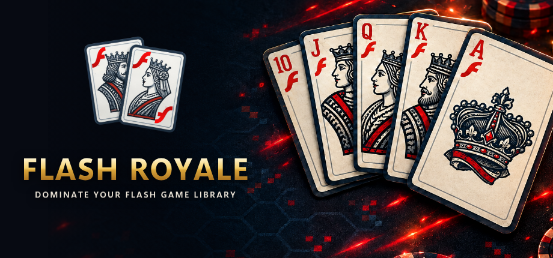

<details>
  <summary>🛑 <b>Windows 11 Smart App Control Block</b></summary><br>
  
> Because this is a **portable .exe** and an open-source project without an expensive commercial signature, **Windows Smart App Control** or **SmartScreen** will block it immediately upon launch. 
> 
> To bypass this restriction, you just need to remove the "Mark of the Web" from the file. Follow these steps before running the app:
>
> 1. Right-click the file "Flash Royale.exe" and select **Properties**.
> 2. At the very bottom of the **General** tab, find the **Security** section.
> 3. Check the box next to **Unblock**.
> 4. Click **Apply**, then click **OK**.
>
> *Alternatively, advanced users can open PowerShell from the app directory and run:*
> ```powershell
> Unblock-File -Path ".\Flash Royale.exe"
> ```
</details>

# Flash Royale [](https://github.com/MCC321-QC/Flash-Royale/releases/latest) [](https://github.com/MCC321-QC/Flash-Royale/releases/download/1.0.1/Flash-Royale-v1.0.1-Windows.zip)

<br>
Flash Royale is a library manager for old flash games that lets you have ultimate control. Automatically play the game music, generate cover arts, organise with categories and tags, track your playtime, show/add tons of metadata and a lot more!

<details>
  <summary>🔍 <b>Features Trailer Video</b></summary><br>

  [](https://www.youtube.com/watch?v=SP8tZXlwx4U)
</details><br>

## Latest Update

[Flash Royale v1.0.1](https://github.com/MCC321-QC/Flash-Royale/releases/download/1.0.1/Flash-Royale-v1.0.1-Windows.zip)<br>
<br>

## Features

<details open>
  <summary>🗂️ <b>Import your local games</b></summary>
  Import Flash and Shockwave games, organize them with categories, tags and favorites, and track your playtime.
</details>
<details>
  <summary>▶️ <b>Flexible game players</b></summary>
  Play with built-in emulators or choose external players, with per-game settings for fullscreen, scaling, volume and more.
</details>
<details>
  <summary>🐧 <b>Wine & Proton compatibility</b></summary>
  Run the Windows version on Linux through Wine or Proton, including Steam integration.
</details>
<details>
  <summary>🎮 <b>Handheld PC support</b></summary>
  Good fit for a handheld device like Steam Deck and ROG Ally.
</details>
<details>
  <summary>🌐 <b>Online catalogs & Flashpoint</b></summary>
  Discover and import games from supported websites, add supported browser-only games, or automatically import your Flashpoint downloads.
</details>
<details>
  <summary>✨ <b>Automatic metadata</b></summary>
  Find missing covers, descriptions, developers, release dates and more after importing games or search manually and choose what to keep.
</details>
<details>
  <summary>📸 <b>Covers & screenshots</b></summary>
  Generate covers automatically, import your own artwork, or capture and crop gameplay screenshots for covers and galleries.
</details>
<details>
  <summary>🎵 <b>Game music</b></summary>
  Automatically extract game music to play it in the library, choose default scanned tracks or custom songs, and optionally normalize their volume.
</details>
<details>
  <summary>🕹️ <b>Controller & touch support</b></summary>
  Navigate the app with a controller, create per-game input mappings, configure on-screen controls, and use the virtual keyboard to enter text in games.
</details>
<details>
  <summary>📖 <b>Guides & video walkthroughs</b></summary>
  Keep manuals, e-books, maps and notes beside your games, with a built-in reader and YouTube/Vimeo video support.
</details>
<details>
  <summary>📺 <b>FPS counter, CRT effects & bezels</b></summary>
  Monitor your FPS, add retro screen filters, reflections and ambient lighting, globally or per game.
</details>
<details>
  <summary>🎨 <b>Highly customizable</b></summary>
  Choose from six themes, customize your own, change cursors, share your modifications, and adjust your library layout.
</details>
<details>
  <summary>🚀 <b>Import in steam & game launchers</b></summary>
  Create desktop shortcuts and Steam library entries/shortcuts with custom icons/artworks, add the game to a launcher like Playnite with its command line start argument or launch directly into a game without opening the library.
</details>
<details>
  <summary>🛡️ <b>Security tools</b></summary>
  Optional antivirus scanning, quarantine, security alerts, signed updates and controls over your games online access.
</details>
<details>
  <summary>🌍 <b>Portable & multilingual</b></summary>
  Keep your library and settings together, play local games offline, and choose from 11 interface languages.
</details><br>

## Documentation

Visit the [Flash Royale Wiki](https://github.com/MCC321-QC/Flash-Royale/wiki) for user guides, player compatibility, controllers, music, themes and troubleshooting.

For contributors: [development](docs/DEVELOPMENT.md), [maintenance and release checklists](docs/maintenance/README.md), and [component licenses and notices](docs/LICENSE-AUDIT.md).
